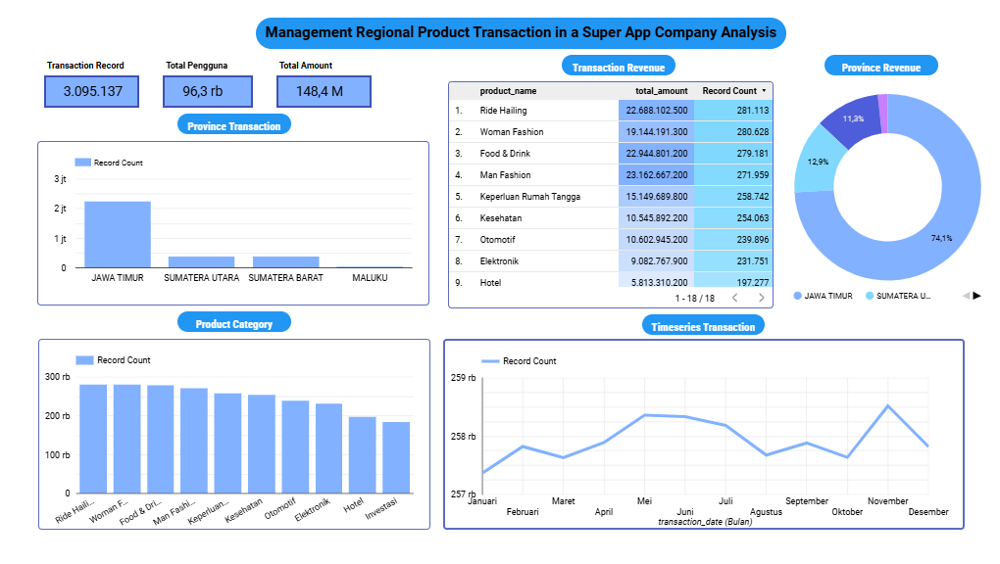

# 📈 Regional Product Trends Through Time Series Forecasting

> Turning transaction history into smarter, region-specific marketing decisions with **Auto-ARIMA**.

---

## 🎯 Overview

This repository contains the artefacts of my **MBKM project in Data Science & AI**. The project forecasts product purchase trends across regions using time series analysis, so businesses can anticipate demand instead of just reacting to it.

## 💡 Business Problem

Consumer behavior changes fast. A product that sells well in one region may stall in another, and marketing teams that rely on past reports often react too late.

The key questions:
- Which products will grow or decline in each region?
- Where should marketing effort be focused next?
- When should existing products be adjusted?

## 🛠️ Solution

I built a forecasting pipeline using **Auto-ARIMA** that:

1. Aggregates transaction data by product and region over time
2. Automatically selects the best ARIMA parameters for each series
3. Predicts future purchase quantities per product per region
4. Presents the results in an interactive dashboard for decision-makers

The outcome is a data-driven basis for **region-specific marketing strategies**.

## 📊 Interactive Dashboard

Explore the forecasting results directly:

*Click the image to open the live dashboard.*

## 🗂️ Dataset

The analysis uses **`maintrx`**, a transaction dataset. Its attributes are shown below:

